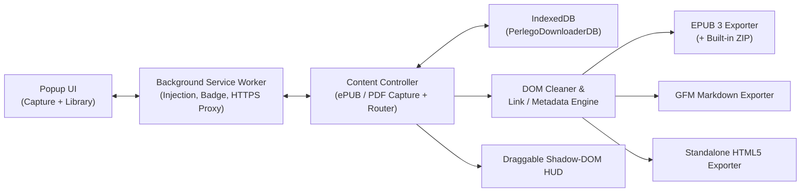

<div align="center">
  
  <h1>Perlego Book Exporter Pro</h1>
  <p><strong>Fast, resumable, zero-dependency Manifest V3 Chrome extension for exporting Perlego books to EPUB 3, GitHub-Flavored Markdown, and standalone HTML5.</strong></p>

  <p>
    
    
    
    
    <a href="LICENSE">
      
    </a>
  </p>
</div>

> **Legal Notice:** An active Perlego subscription is required. Exported materials must be used strictly in compliance with Perlego's Terms of Service and applicable copyright laws. This project is not affiliated with or endorsed by Perlego.

---

## Features

| Capability | Details |
| :--- | :--- |
| **Spec-Compliant EPUB 3 (`.epub`)** | Pure-JS OCF ZIP packaging (`CompressionStream`), strict XHTML5 serialization, **MathML** preservation (`properties="mathml"`), inline **SVG**, nested hierarchical TOC (`nav.xhtml` & `toc.ncx` with `dtb:depth`), EPUB 3 Landmarks, and automatic WebP → JPEG cover conversion. |
| **Rich Metadata & RTL Support** | Automatically extracts title, subtitle, affiliation-free authors, publisher, publication year, and ISBN-13/10 from front matter; auto-detects language and **RTL direction** (`dir="rtl"`, `page-progression-direction="rtl"`) for Persian, Arabic, and Hebrew books. |
| **GitHub-Flavored Markdown (`.md`)** | Clean YAML frontmatter, indented hierarchical TOC, resolved internal section links, GFM tables (with captions), nested lists, definition lists (`<dl>`), fenced code blocks with language detection, and TeX math (`$` / `$$`). |
| **Standalone HTML5 Reader (`.html`)** | Print-ready offline book with optional inlined images, hierarchical TOC, print-hidden reader toolbar (3-state **System / Light / Dark** color-scheme control, font sizing, and one-click **Print / Save PDF**). |
| **Two-Pass Book-Wide Link Resolver** | Repairs `#fragment` footnotes/endnotes, `scrollWithinBook()` links, TOC entries, Figure/Table/Box references, author-year citations, and print page-number anchors across chapters. |
| **Resumable $O(1)$ IndexedDB Cache** | Per-book IndexedDB storage (`PerlegoDownloaderDB`) with pause/resume, optional **section/page range capture (`From`–`To`)**, and a built-in **Library** tab to inspect storage usage, export cached books, or delete individual books. |
| **Memory-Efficient Asset Pipeline** | Parallel worker pool with exponential backoff retries, automatic `<picture>` fallback URL recovery, full `AbortSignal` cancellation, and lazy `dataUrl` generation (~60% lower RAM usage for EPUB exports). |
| **Draggable Shadow-DOM HUD & Badge** | Non-intrusive in-page progress HUD with accurate ETA, skipped-section badges, **Issues** log filter, and per-tab toolbar badge status (`%`, `II`, `EXP`, `OK`, `!`). |

---

## Architecture



---

## Installation

### Option 1: Load Unpacked (Recommended for Development)

1. Clone this repository or download a release ZIP from [Releases](https://github.com/iamMortazavi/perlego-book-exporter/releases).
2. Open `chrome://extensions` in Chrome, Brave, Arc, Edge, or another Chromium-based browser.
3. Enable **Developer mode** (top-right toggle).
4. Click **Load unpacked** and select the project root directory (or the unzipped release folder).

### Usage

1. Open any book on `https://ereader.perlego.com/1/book/<BOOK_ID>`.
2. Click the **Perlego Book Exporter Pro** extension icon.
3. Select one or more output formats (**EPUB 3**, **Markdown**, **HTML5**), capture mode, speed preset, and optional section range (`From`–`To`).
4. Click **Start Capture & Export** (or **Export Cached** if chapters are already cached).
5. Use the **Library** tab at any time to view, export, or remove previously cached books.

---

## Project Structure

```text
perlego-book-exporter/
├── manifest.json              # Chrome Extension Manifest V3 configuration
├── package.json               # Verification, test, and packaging scripts
├── assets/
│   ├── logo.png               # 512×512 extension logo
│   └── icons/                 # 16×16, 48×48, 128×128 extension icons
├── src/
│   ├── background.js          # MV3 service worker (injection, badge, asset proxy)
│   ├── content-main.js        # Reader capture engine & message router
│   ├── exporters/
│   │   ├── epub.js            # EPUB 3.0 generator (MathML, SVG, nested TOC, RTL)
│   │   ├── html.js            # Standalone offline HTML5 reader exporter
│   │   └── markdown.js        # GitHub-Flavored Markdown exporter
│   ├── lib/
│   │   └── zip.js             # Zero-dependency PKZIP / OCF writer
│   ├── popup/
│   │   ├── popup.html         # Accessible two-tab popup UI
│   │   ├── popup.css          # Adaptive light/dark popup stylesheet
│   │   └── popup.js           # Popup state, settings & Library manager
│   ├── storage/
│   │   └── db.js              # IndexedDB per-book persistence layer
│   ├── ui/
│   │   └── hud.js             # Draggable Shadow-DOM progress & log HUD
│   └── utils/
│       ├── async.js           # MutationObserver waits, mapPool, backoff retries
│       └── dom-cleaner.js     # Sanitizer, asset fetcher, metadata & link resolver
├── scripts/
│   ├── check.mjs              # Manifest, icon dimensions, and syntax validator
│   └── pack.mjs               # Reproducible extension ZIP packager
└── tests/
    ├── dom-shim.mjs           # Lightweight DOM/XML test shim for Node.js
    └── extension.test.mjs     # Unit & strict EPUB 3 XML validation test suite
```

---

## Development & Verification

Requires **Node.js 18+** (zero `npm install` needed) and **Python 3** + `unzip` for strict EPUB XML/ZIP integrity checks.

```bash
# Validate manifest.json, icon dimensions, and JS syntax
npm run check

# Run the automated unit & EPUB 3 XML validation test suite
npm test

# Run all checks + tests together
npm run verify

# Build a clean Chrome-ready extension ZIP into dist/
npm run pack
```

---

## Documentation

- [CHANGELOG.md](CHANGELOG.md) — Release history and upgrade highlights
- [ROADMAP.md](ROADMAP.md) — Planned milestones for v4.2 – v5.0
- [CONTRIBUTING.md](CONTRIBUTING.md) — Development workflow and contribution guidelines
- [PRIVACY.md](PRIVACY.md) — Local-only data handling and permission disclosures

## License

Released under the [MIT License](LICENSE).
