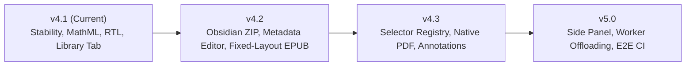

# Development Roadmap

This document outlines the planned evolution of **Perlego Book Exporter Pro** following v4.1.0.

## Phase 1 — v4.2 (Enhanced Export Formats & Authoring Controls)

- **Obsidian / Notion Markdown Bundle (`.zip`)**: Package Markdown (single file or one file per chapter) alongside a local `assets/` directory with rewritten relative image links so exported notes stay fully offline.
- **Pre-Export Metadata & Cover Editor**: Allow editing title, subtitle, author, publisher, year, ISBN, language, and uploading a custom cover image prior to packaging.
- **EPUB 3 Fixed-Layout for PDF Books**: Emit `rendition:layout = pre-paginated` and explicit page `viewport` metadata for fixed-layout PDF books to improve rendering in Apple Books, Kindle, and Thorium Reader.
- **EPUB 3 Popup Footnotes**: Automatically annotate resolved footnote references and targets with `epub:type="noteref"` and `epub:type="footnote"` for native popup footnotes.

## Phase 2 — v4.3 (Resilience, Native PDF & Annotations)

- **Adaptive Selector Registry**: Extract all Perlego DOM locators into a dedicated adapter module (`src/adapters/perlego-selectors.js`) with multi-tier fallbacks to simplify maintenance when reader markup changes.
- **Direct Multi-Page PDF Export**: Add a lightweight client-side PDF writer for scanned/image-based Perlego PDFs without relying on the browser Print dialog.
- **Optional IndexedDB Asset Cache**: Cache downloaded binary images in an LRU-managed IndexedDB object store so re-exporting in another format avoids re-fetching CloudFront assets.
- **Highlights & Notes Export**: Export user highlights and notes into Markdown, JSON, and Readwise-compatible CSV formats.

## Phase 3 — v5.0 (Next-Gen Extension Architecture)

- **Chrome Side Panel Workspace (`chrome.sidePanel`)**: Provide a persistent side panel displaying an interactive chapter checklist, live TOC preview, filterable diagnostics, and cached book library without closing on page interaction.
- **Web Worker / Offscreen Packaging**: Move ZIP compression and WebP → JPEG transcoding off the page main thread for smooth performance on 1,000+ page volumes.
- **Automated E2E & W3C EPUBCheck CI**: Add Playwright browser smoke tests and W3C `epubcheck` validation in GitHub Actions.
- **Localization (`_locales`)**: Add multi-language UI support via `chrome.i18n`.
